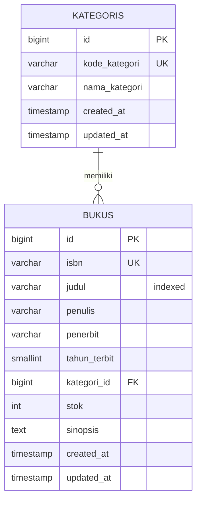

# 📚 SIPUS-Del — Sistem Informasi Perpustakaan Kampus Del

pustakawan@del.ac.id 
password123

**Tugas Mandiri Minggu 05** · 12S3101 Pemrograman & Pengujian Web · Institut Teknologi Del · Ganjil 2026/2027

| | |
|---|---|
| **Nama** | Arya Pratama Sinambela |
| **NIM** | 12S24017 |
| **Dosen** | Chandro Pardede, S.Kom., M.Sc. |
| **Stack** | Laravel, PHP 8.2+, MySQL 8.0, Bootstrap 5 (CDN), Blade |

Aplikasi CRUD katalog buku dan kategori dengan arsitektur **Model-View-Controller (MVC)** *server-side rendering*, bertema **Del Purple (#4C1D95)**.

## ✨ Fitur

- CRUD **Buku** dan **Kategori** lewat `Route::resource` (7 aksi) dengan *implicit route model binding*
- Relasi Eloquent: `Kategori hasMany Buku` dan `Buku belongsTo Kategori`
- **Eager loading** (`Buku::with('kategori')`) untuk mencegah N+1 query
- Validasi server-side (`$request->validate()`) dan proteksi **CSRF** + method spoofing di semua form
- Blade component `<x-layout>`, pagination Bootstrap 5, flash message, `@forelse` untuk data kosong
- UI: latar rak buku, tabel dengan status stok (Tersedia / Menipis / Habis), baris yang bisa dipilih, pencarian cepat di halaman aktif
- **Seeder & Factory**: 5 kategori dan 20 buku (judul, penulis, penerbit ditulis manual; ISBN dan stok dibuat Faker)

> ISBN pada data seeder adalah **data contoh dari Faker**, bukan ISBN asli buku.

## 🗂️ Struktur MVC

| Lapisan | Lokasi | Tanggung jawab |
|---|---|---|
| Model | `app/Models/Buku.php`, `Kategori.php` | Struktur data, relasi, `$fillable` |
| View | `resources/views/buku/*`, `kategori/*`, `components/layout.blade.php` | Tampilan (Blade), tanpa kueri SQL |
| Controller | `app/Http/Controllers/BukuController.php`, `KategoriController.php` | Menerima request, validasi, memanggil Model, memilih View |
| Route | `routes/web.php` | `Route::resource('buku')` dan `Route::resource('kategori')` |

## 🧩 Skema Database



Foreign key `bukus.kategori_id` memakai `restrictOnDelete`, jadi kategori yang masih punya buku **tidak bisa dihapus** (aplikasi menampilkan pesan error, bukan menghapus buku diam-diam).

## 🛣️ Route

| Method | URI | Nama | Aksi |
|---|---|---|---|
| GET | `/buku` | `buku.index` | Daftar buku (eager loading + pagination) |
| GET | `/buku/create` | `buku.create` | Form tambah |
| POST | `/buku` | `buku.store` | Simpan (validasi) |
| GET | `/buku/{buku}` | `buku.show` | Detail |
| GET | `/buku/{buku}/edit` | `buku.edit` | Form edit |
| PUT/PATCH | `/buku/{buku}` | `buku.update` | Perbarui (validasi) |
| DELETE | `/buku/{buku}` | `buku.destroy` | Hapus |

Route `kategori.*` mengikuti pola yang sama. Daftar lengkap: `php artisan route:list --except-vendor`.

## 🔒 Validasi & Keamanan

| Kolom | Aturan |
|---|---|
| `isbn` | wajib, 10-13 digit angka, **unik** |
| `judul` | wajib, **minimal 5** karakter, maksimal 200 |
| `penulis`, `penerbit` | wajib, maksimal 150 |
| `tahun_terbit` | wajib, angka antara 1900 dan tahun berjalan |
| `kategori_id` | wajib, harus ada di tabel `kategoris` |
| `stok` | wajib, bilangan bulat **minimal 0** |
| `sinopsis` | opsional |

- Semua form memakai `@csrf`, dan `@method('PUT')` / `@method('DELETE')` untuk method spoofing.
- Mass assignment dilindungi `$fillable` pada kedua model.
- Output Blade memakai `{{ }}` sehingga di-*escape* otomatis (anti-XSS).

## 🚀 Instalasi

**Kebutuhan:** PHP 8.2+ (ekstensi `pdo_mysql`, `mbstring`, `openssl`), Composer 2.6+, MySQL 8.0.

```bash
git clone https://github.com/AryaSinambela/ppw-2026-week5-12S24017.git
cd ppw-2026-week5-12S24017

composer install
cp .env.example .env
php artisan key:generate
```

Buat database, lalu sesuaikan `DB_USERNAME` dan `DB_PASSWORD` di `.env` bila perlu:

```bash
mysql -u root -e "CREATE DATABASE sipus_del CHARACTER SET utf8mb4 COLLATE utf8mb4_unicode_ci;"
```

Jalankan migrasi dan seeder, lalu server:

```bash
php artisan migrate:fresh --seed
php artisan serve
```

Buka **http://127.0.0.1:8000**.

> `migrate:fresh` menghapus semua tabel sebelum membuat ulang. Gunakan hanya pada database latihan.

**Alternatif tanpa Artisan:** impor dump yang sudah disertakan.

```bash
mysql -u root sipus_del < database/sipus_del.sql
```

## 🔍 Bukti Eager Loading (Audit SQL)

`AppServiceProvider::boot()` memasang `DB::listen` yang mencatat query ke tabel `bukus` dan `kategoris` ke `storage/logs/laravel.log`. Log berikut dihasilkan saat membuka `/buku`:

```
(tempel 3 baris [SQL AUDIT] hasil `tail -n 20 storage/logs/laravel.log` di sini)
```

Halaman index menjalankan **3 query tetap**, berapa pun jumlah bukunya:

1. [2026-10-12 01:38:42] local.INFO: [SQL AUDIT] (1.38 ms) select count(*) as `aggregate` from `bukus`
2. [2026-10-12 01:38:42] local.INFO: [SQL AUDIT] (1.39 ms) select * from `bukus` order by `created_at` desc limit 10 offset 0
3. [2026-10-12 01:38:42] local.INFO: [SQL AUDIT] (1.57 ms) select * from `kategoris` where `kategoris`.`id` in (1, 2)

Tanpa eager loading, setiap baris memicu 1 query tambahan ke `kategoris` (N+1 problem), sehingga 10 buku menghasilkan 12 query. Catatan: modul menyebut "2 query", tetapi `paginate()` menambah 1 query `count`, dan inti pembuktiannya tetap sama (tidak ada query per baris).

## 🖼️ Screenshot

| Daftar Buku | Tambah Buku | Validasi Error |
|---|---|---|
|  |  |  |

## 🧾 Riwayat Commit

Pesan commit mengikuti Conventional Commits (`feat(migration)`, `feat(model)`, `feat(controller)`, `feat(views)`, `perf(eager-loading)`).

## 📄 Lisensi

Dibangun di atas [Laravel](https://laravel.com) (lisensi MIT). Proyek ini dibuat untuk keperluan tugas perkuliahan.